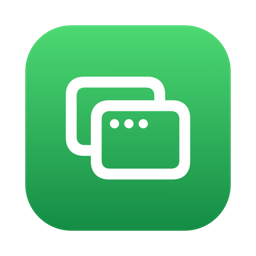

# DeClutter for Mac

Too many apps and browser windows open? One click and every window shrinks into its app's Dock icon, leaving a
clean desktop. Click again and everything comes back where it was, with you in the app you were using.

Free. No account, no ads, no tracking, and it never uses the internet.

<p align="center"></p>

## Download

**[Download DeClutter-mac.zip](https://github.com/danpune/declutter-mac/releases/latest/download/DeClutter-mac.zip)**
(about 300 KB, macOS 14 or later, Apple silicon or Intel)

1. Double-click the zip, then drag **DeClutter** into your **Applications** folder and open it.
2. macOS says it can't check the app, because it isn't signed with a paid Apple developer account.
   Open **System Settings → Privacy & Security**, scroll down, click **Open Anyway** next to "DeClutter",
   and enter your password ([Apple's guide](https://support.apple.com/guide/mac-help/open-a-mac-app-from-an-unknown-developer-mh40616/mac)).
3. DeClutter appears in the Dock and as a green icon in the menu bar. It opens by itself when you log in.
4. The first time you declutter, macOS asks to let DeClutter control your computer. Click **Open System Settings**
   and turn on **DeClutter** under Accessibility. That's what lets windows shrink into the Dock; without it,
   DeClutter still works, but apps vanish instantly instead.

## How to use it

**Click DeClutter's Dock icon, click its green menu bar icon, or press ⌃⌥D** from any app. Every window shrinks
into its app's Dock icon. Do it again to bring everything back. While the screen is clear, the menu bar icon turns
into a green ↩︎ arrow.

**Right-click** either icon for the menu:

| | |
|---|---|
| **Declutter** / **Restore Apps** | Same as clicking the icon. |
| **Restore Everything** | Brings back every hidden app and every minimized window, including ones you put away yourself. |
| **Quit Menu Bar Apps…** | Quits the menu bar utilities (apps with no Dock icon), after showing you the list. **Reopen Menu Bar Apps** brings them back. |
| **Arrange Menu Bar…** | Opens macOS's own menu bar settings, to hide other apps' icons. To reorder icons, hold ⌘ and drag them. |
| **Never Hide or Quit** | Tick apps to leave alone, such as music, a video call or a dictation tool. |
| **Change Shortcut…** | Press any combination with ⌘, ⌃ or ⌥. A global shortcut takes that key from every other app, so pick one you don't use elsewhere. |
| **Animate** | On: windows shrink into the Dock (needs the Accessibility permission). Off: apps hide instantly, no permission needed. |
| **Show in Dock**, **Open at Login** | On by default. The Dock icon is handy on MacBooks whose notch hides some menu bar icons. |

Quitting DeClutter while the screen is clear brings everything back first, so nothing is ever left stranded.

## Privacy

DeClutter never connects to the internet. The Accessibility permission is used only to minimize and restore
windows. The keyboard shortcut uses the standard macOS hot key service, which doesn't need Input Monitoring.

## Build it yourself

Needs only the Xcode Command Line Tools:

```
./build.sh            # builds build/DeClutter.app (universal)
./build.sh install    # also copies it to /Applications and opens it
./build.sh release    # also zips it for GitHub Releases
./test.sh             # declutters and restores the installed app, and checks every window came back
```

The first build creates a signing certificate that exists only on your Mac, in its own keychain under
`~/.config/declutter`. Every build then has the same identity, so macOS keeps DeClutter's Accessibility
permission across rebuilds (an ad-hoc signature would look like a new app each time). Delete that folder to start
over; you'll grant the permission once more.

One Swift file, AppKit only. Animate minimizes each app's front window and hides the app a moment later, so
everything clears together in under a second even with dozens of windows open.

MIT licensed.
