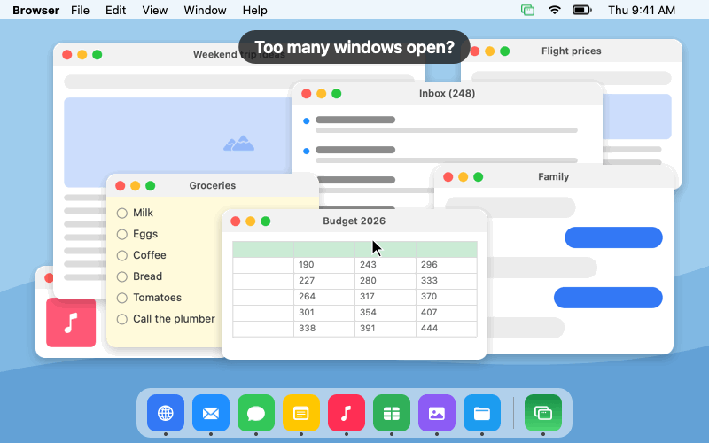
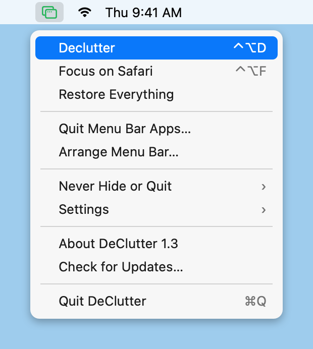

#  DeClutter for Mac

Too many apps and browser windows open? One click and every window shrinks into its app's Dock icon, leaving a
clean desktop. Click again and everything comes back where it was, with you in the app you were using. Or keep just
the app you're working in and clear everything else.

Free. No account, no ads, no tracking. The only time it goes online is to check for a newer version of itself.

<p align="center"></p>

## Download

**[Download DeClutter-mac.zip](https://github.com/danpune/declutter-mac/releases/latest/download/DeClutter-mac.zip)**
(about 300 KB, macOS 14 or later, Apple silicon or Intel)

1. Double-click the zip, then drag **DeClutter** into your **Applications** folder and open it.
2. macOS says it can't check the app, because it isn't signed with a paid Apple developer account.
   Open **System Settings → Privacy & Security**, scroll down, click **Open Anyway** next to "DeClutter",
   and enter your password ([Apple's guide](https://support.apple.com/guide/mac-help/open-a-mac-app-from-an-unknown-developer-mh40616/mac)).
3. DeClutter appears in the Dock and as a green icon in the menu bar, and says hello. It opens by itself when you log in.
4. Click **Allow Animation…**, then **Open System Settings**, and turn on **DeClutter** under Accessibility. That's what
   lets windows shrink into the Dock; without it, DeClutter still works, but apps vanish instantly instead.

**Updates:** DeClutter checks for a new version when it starts and every 12 hours, and tells you when there is one.
Click **Update** and it installs itself and reopens, keeping your settings and permission. (Coming from version 1.2 or
earlier? Download the latest version once by hand; after that it updates itself.)

## How to use it

**Click DeClutter's Dock icon, click its green menu bar icon, or press ⌃⌥D** from any app. Every window shrinks
into its app's Dock icon. Do it again to bring everything back. While the screen is clear, the menu bar icon turns
into a green ↩︎ arrow.

**Option-click the menu bar icon, or press ⌃⌥F,** to focus: everything clears except the app you're in. Do it again
to bring the rest back.

Tip: for a completely clean screen when presenting or sharing it, hide the desktop's files too: **System Settings →
Desktop & Dock**, and under **Show Items**, untick **On Desktop**.

**Right-click** either icon for the menu:

<p align="center"></p>

| Menu item | What it does |
|---|---|
| **Declutter** / **Restore Apps** | Same as clicking the icon. |
| **Focus on** *app* | Clears everything except the app you're in. Same as Option-clicking the icon. |
| **Restore Everything** | Brings back every hidden app and every minimized window, including ones you put away yourself. |
| **Quit Menu Bar Apps…** | Quits the menu bar utilities (apps with no Dock icon), after showing you the list. **Reopen Menu Bar Apps** brings them back. |
| **Arrange Menu Bar…** | Opens macOS's own menu bar settings. On macOS 26 or later that's where you hide other apps' icons; earlier versions only cover Apple's. To reorder icons, hold ⌘ and drag them. |
| **Never Hide or Quit** | Tick apps to leave alone, such as music, a video call or a dictation tool. |
| **Settings ▸ Change Shortcut…**, **Change Focus Shortcut…** | Press any combination with ⌘, ⌃ or ⌥. A global shortcut takes that key from every other app, so pick one you don't use elsewhere. macOS's own shortcuts (like ⌘Space) and ones every app needs (like ⌘C or ⌘Q) are refused. |
| **Settings ▸ Animate** | On: windows shrink into the Dock (needs the Accessibility permission). Off: apps hide instantly, no permission needed. |
| **Settings ▸ Only the Screen Under the Pointer** | With more than one display, clears only the one your pointer is on; the others stay as they are. Needs the Accessibility permission. |
| **Settings ▸ Hide Apps Not Used For** | Hides apps you haven't switched to for 5, 15 or 30 minutes or an hour, like ⌘H. Never the app you're in, or ones under Never Hide or Quit (keep a video or music app there). Off by default. |
| **Settings ▸ Show in Dock**, **Open at Login** | On by default. The Dock icon is handy on MacBooks whose notch hides some menu bar icons. |
| **Settings ▸ Check for Updates Automatically** | On by default: asks GitHub for a newer version when DeClutter starts and every 12 hours. |
| **About DeClutter** | Your version, what's new in each version, and the source code. |
| **Check for Updates…** | Checks now. When there's a newer version it reads **Update to Version…** |

Quitting DeClutter while the screen is clear brings everything back first, so nothing is ever left stranded.

## Privacy

DeClutter goes online only to ask GitHub whether there's a newer version (when it starts, every 12 hours, and when you
click Check for Updates) and to download an update you said yes to. All it sends is its own version number (GitHub,
like any website, sees your IP address); untick **Check for Updates Automatically** to stop the automatic checks. An update is installed only if it's signed with the same certificate as
the copy you have. The Accessibility permission is used only to minimize and restore windows. The keyboard shortcut uses the standard macOS hot key service, which doesn't need Input Monitoring.

## Build it yourself

Needs only the Xcode Command Line Tools:

```
./build.sh            # builds build/DeClutter.app (universal)
./build.sh install    # also copies it to /Applications and opens it
./build.sh release    # also zips it for GitHub Releases
./test.sh             # declutters and restores the installed app, and checks every window came back
swift docs/make-images.swift   # redraws the pictures in this README (drawn in code, not screenshots)
```

The first build creates a signing certificate that exists only on your Mac, in its own keychain under
`~/.config/declutter`. Every build then has the same identity, so macOS keeps DeClutter's Accessibility
permission across rebuilds (an ad-hoc signature would look like a new app each time). Delete that folder to start
over; you'll grant the permission once more. A copy you build yourself has your own certificate, so it won't install
this repo's releases by itself: it offers the download instead.

One Swift file, AppKit only. Animate minimizes each app's front window and hides the app a moment later, so
everything clears together in under a second even with dozens of windows open.

MIT licensed.
